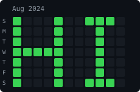

# gha-contribution-ascii

> GitHub Action that writes ASCII text or pixel art on your GitHub contribution graph using backdated commits — pure bash, default `GITHUB_TOKEN`, no PAT required.

[](LICENSE)
[](CHANGELOG.md)


## What

- Pure bash composite action — no Docker, no Python runtime
- Works with the default `GITHUB_TOKEN` (PAT only needed for compensation)
- 5×7 font (A–Z, 0–9, space, punctuation) or raw `BITMAP` for custom pixel art
- Backdating via `START_DATE`; multi-year paints supported (compensation queries each spanned year)
- Pushes to `gh-pages` so art stays out of `main`
- Compensation, inverse, and dry-run modes built in

<details>
<summary>Proof of work</summary>

"HI" painted on the contribution graph starting August 4, 2024 (backdated from March 2026):



Verified via GitHub GraphQL API — each green cell has 4+ backdated commits authored as `<user>@users.noreply.github.com`.

</details>

<details>
<summary>Disclaimer — backdating has no lower limit</summary>

This action creates commits with arbitrary `GIT_AUTHOR_DATE` timestamps. There is
**no technical limit** on how far back commits can be backdated — including dates
before Git (2005), before GitHub (2008), and even before Unix epoch (1970). We have
successfully written "FIRLEFANZ" to the contribution graph starting
**January 4, 1970**. Use responsibly. Contributions generated this way are
indistinguishable from real activity on the graph. To undo, delete the `gh-pages`
branch — contributions disappear within 24 hours.

</details>

## How

7 rows = days of the week, each column = one week. The action renders `TEXT` or `BITMAP` to a 7-row matrix, optionally compensates for existing contributions, then creates backdated commits on `gh-pages`.

```yaml
permissions:
  contents: write

steps:
  - uses: qte77/gha-contribution-ascii@v2
    with:
      TEXT: "HI"
```

Inputs, backdating, `BITMAP` pixel art, dry runs, scheduled workflows, token modes, and limitations: see [Advanced Usage](docs/advanced-usage.md).

## Why

Contribution-graph painters typically need Docker, a language runtime, or a personal access token. This action is a pure-bash composite step that runs on the default `GITHUB_TOKEN` with no extra dependencies, and keeps the art on `gh-pages`, out of `main`.

## Refs

- [Advanced Usage](docs/advanced-usage.md)
- [CHANGELOG](CHANGELOG.md)
- [Development and tests](docs/advanced-usage.md#development)
- [GitHub docs: viewing contributions on your profile](https://docs.github.com/en/account-and-profile/how-tos/contribution-settings/viewing-contributions-on-your-profile)

## License

Apache-2.0 — see [LICENSE](LICENSE).
